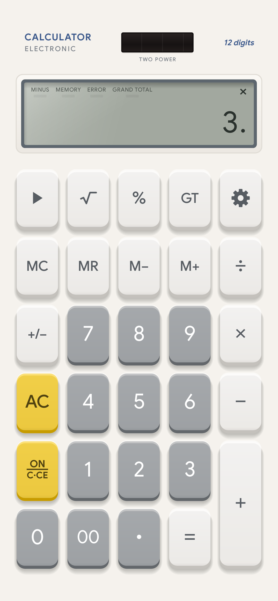
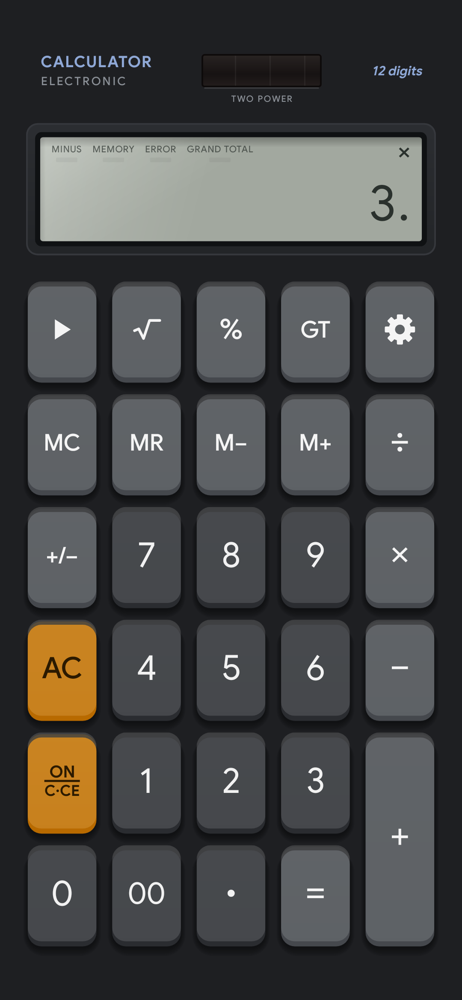
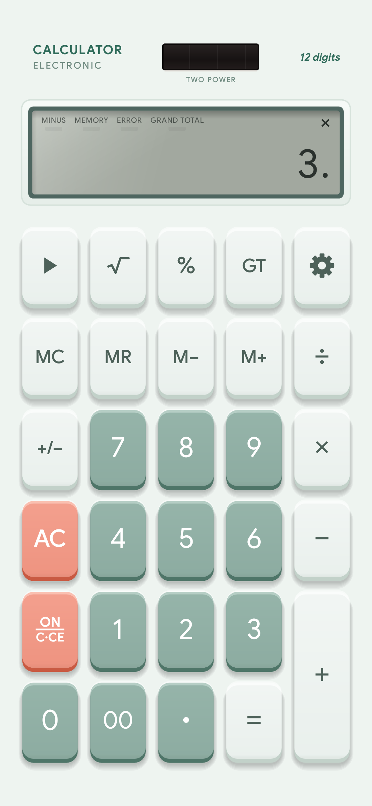
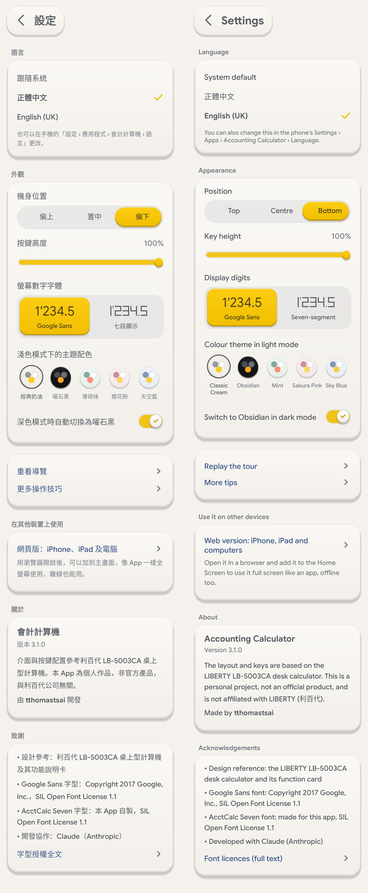

# AcctCalc

**English (GB)** · [正體中文](#正體中文)

| Classic Cream | Obsidian | Mint | Sakura Pink | Sky Blue |
|---|---|---|---|---|
|  |  |  |  |  |

---

## English (GB)

An Android app modelled on the 12-digit business calculator on my desk. The key layout, colours and calculation rules follow the real device and the function card printed on the back of its packaging. The interface is redrawn natively with Android Canvas, keeping the depth of the keys, the soft shadows and the press-and-spring-back feel. On the home screen it appears as **Accounting Calculator** (or **會計計算機** when the phone is set to Chinese), so it is not confused with the phone's built-in calculator.

> The layout and key arrangement are based on the LIBERTY LB-5003CA desk calculator. This is a personal project, not an official product, and is not affiliated with LIBERTY (利百代).

### Installation

Download [`dist/Calculator-v2.9.apk`](dist/Calculator-v2.9.apk), open it on an Android phone and allow *Install unknown apps*. Requires Android 6.0 or later.

### Keys and calculation rules

| Key | Behaviour |
|---|---|
| `+ − × ÷` | Chain calculation; while the second number is being entered, the pending operator is shown in the top-right corner of the display |
| `=` (constant calculation) | After a calculation, enter a new number and press `=` to repeat the same operation, or press `=` again to repeat it on the result; see below |
| `%` | `3000 × 20 %` → 600; `3000 + 20 %` → 3'600 (add-on); `3000 − 20 %` → 2'400 (discount); `20 ÷ 500 %` → 4 |
| `√` | Square root of the displayed number; can be used within a calculation (`9 √ × 6 =` → 18) |
| `M+` `M−` `MR` `MC` | Memory; if a calculation is still pending, it is completed before the result is stored |
| `GT` | Every result from `=` or `%` is added to the grand total (a result finished by `M+` / `M−` is not). Press once to recall it; pressing again (second press onwards) clears the grand total while the display stays as it is |
| `ON/C·CE` | First press clears the number just entered (CE); second press clears the calculation (C). GT and memory are kept |
| `AC` | Clears everything, including GT and memory |
| `▶` | Deletes the last digit |
| `⚙` | Settings (in place of the OFF key) |

#### Constant calculation

Once a calculation is done, the calculator keeps one of its numbers as a constant. Enter a new number and press `=`, and the same operation is applied with that constant. For × the constant is the **first** number; for +, − and ÷ it is the **second**.

| Operation | Constant kept | Example | What is calculated |
|---|---|---|---|
| × | first number | `54 × 5 =` → 270, then `2 =` → 108, `3 =` → 162 | 54 × 2, 54 × 3 |
| ÷ | second number (divisor) | `240 ÷ =` → 0.00416666667, then `2 =` → 0.00833333333, `5 =` → 0.02083333333 | 1 ÷ 240, 2 ÷ 240, 5 ÷ 240 |
| + | second number | `5 + 5 =` → 10, then `6 =` → 11, `7 =` → 12, `10 =` → 15 | 6 + 5, 7 + 5, 10 + 5 |
| − | second number | `5 − 1 =` → 4, then `3 =` → 2 | 3 − 1 |

- Pressing `=` straight after the operator uses the displayed number as the second operand: `20.5 × =` → 420.25 (square); `240 ÷ =` → 1 ÷ 240 (reciprocal), with 240 kept as the divisor.
- Pressing `=` again repeats the operation on the result: `345 + 67 = =` → 479; `678 − 12 = = =` → 642; `5 ÷ = = = =` → 0.0016 (5⁻⁴).
- Example — sharing $10 in proportion to $60, $30 and $10 (total $100): `10 ÷ 100 =` → 0.1, then `× 60 =` → 6; 0.1 is now the constant, so `30 =` → 3 and `10 =` → 1.

Display:

- Whole numbers always show a decimal point (`0.`, `190.`), and thousands are separated with `'` (`3'600.`).
- MINUS, MEMORY, ERROR and GRAND TOTAL are printed along the top; a bar lights up beneath whichever is active.
- For a negative number that fills all 12 digits, the sign is shown by the MINUS indicator; otherwise the minus sign sits in front of the number.
- Results over 12 digits show ERROR with the first 12 significant digits (`123456789 × 8888 =` → `E 1.09728394063`). Pressing CE clears the error so you can carry on calculating.

### Settings

| Option | Choices |
|---|---|
| Language | 正體中文 / English (UK); follows the system language on first launch |
| Position | Top / Centre / Bottom |
| Key height | 60%–100% |
| Colour theme | Classic Cream, Obsidian, Mint, Sakura Pink, Sky Blue |



### Building and testing

No Android Studio or Gradle needed. On Ubuntu / Debian:

```bash
sudo apt install aapt dalvik-exchange apksigner zipalign android-sdk-platform-23 openjdk-17-jdk
./build.sh
```

`build.sh` first runs the 79 test cases in `test/cases.txt` against the calculation engine (including every example on the function card). Only if they all pass does it compile and sign `build/Calculator.apk`.

### Project structure

```
app/src/tw/thomas/calc/
  CalcEngine.java    Calculation logic (plain Java, testable on a computer)
  CalcView.java      Calculator face and key animation (drawn with Canvas)
  MainActivity.java  Settings panel and saved preferences
  Theme.java         The five colour themes
  I18n.java          Chinese and English strings
app/assets/fonts/    Google Sans (SIL Open Font Licence 1.1)
test/                Calculation tests
web-prototype/       The first prototype, built as a web page (HTML/JS)
docs/                Screenshots and the AI usage evidence card
```

### How it was made

1. Built a web prototype first (`web-prototype/`) and tuned its appearance against photos of the real calculator.
2. Corrected the display and calculation rules against the function card on the packaging.
3. Rewrote it as a fully native Android app (Java + Canvas), without a WebView.
4. Added settings for key height, colour theme, position and language, and turned the OFF key into a settings key.

The record of how AI was used is in [`docs/AI-使用證據卡.md`](docs/AI-使用證據卡.md) (in Chinese).

### Licence

The Google Sans font is licensed under the SIL Open Font Licence 1.1; see `app/assets/fonts/OFL.txt`.

---

## 正體中文

[English (GB)](#english-gb) · **正體中文**

我把桌上那台 12 位數商用計算機做成 Android App。按鍵配置、配色和運算規則都照實機與包裝背面的功能說明卡；畫面用 Android 原生 Canvas 重畫，保留按鍵的厚度、柔和陰影和按壓回彈的手感。手機語言是中文時，App 在桌面上的名稱是 **會計計算機**，其他語言是 **Accounting Calculator**，以免跟手機內建的計算機搞混。

> 介面與按鍵配置參考利百代 LB-5003CA 桌上型計算機。本專案為個人作品，非官方產品，與利百代公司無關。

### 安裝

下載 [`dist/Calculator-v2.9.apk`](dist/Calculator-v2.9.apk)，在 Android 手機上開啟並允許「安裝不明來源的應用程式」。需要 Android 6.0 以上。

### 按鍵與運算規則

| 按鍵 | 行為 |
|---|---|
| `+ − × ÷` | 連續計算；輸入第二個數時，螢幕右上會顯示目前的運算符號 |
| `=`（常數計算） | 算完一次後，輸入新數字再按 `=` 會重複同樣的運算；直接再按 `=` 則對結果重複運算，見下方說明 |
| `%` | `3000 × 20 %` → 600；`3000 + 20 %` → 3'600（加成）；`3000 − 20 %` → 2'400（折扣）；`20 ÷ 500 %` → 4 |
| `√` | 對螢幕上的數開根號，可以接在算式中（`9 √ × 6 =` → 18） |
| `M+` `M−` `MR` `MC` | 記憶運算；有算式還沒算完時，會先算出結果再存入 |
| `GT` | 每次按 `=` 或 `%` 的結果都會累加到 GT（用 `M+`／`M−` 算出的結果不會）。按一下叫出；連按第二下起清空 GT，螢幕數字不變 |
| `ON/C·CE` | 第一下清除剛輸入的數（CE），第二下清除算式（C）；GT 與 M 保留 |
| `AC` | 全部清除，包含 GT 與 M |
| `▶` | 刪除最後一位 |
| `⚙` | 設定（原本 OFF 鍵的位置） |

#### 常數計算

算完一次之後，計算機會記住其中一個數當「常數」。輸入新數字再按 `=`，就會用同樣的運算套上這個常數。乘法記住的是**第一個數**，加、減、除記住的是**第二個數**。

| 運算 | 記住的常數 | 例子 | 實際算的是 |
|---|---|---|---|
| × | 第一個數 | `54 × 5 =` → 270，接著 `2 =` → 108、`3 =` → 162 | 54 × 2、54 × 3 |
| ÷ | 第二個數（除數） | `240 ÷ =` → 0.00416666667，接著 `2 =` → 0.00833333333、`5 =` → 0.02083333333 | 1 ÷ 240、2 ÷ 240、5 ÷ 240 |
| + | 第二個數 | `5 + 5 =` → 10，接著 `6 =` → 11、`7 =` → 12、`10 =` → 15 | 6 + 5、7 + 5、10 + 5 |
| − | 第二個數 | `5 − 1 =` → 4，接著 `3 =` → 2 | 3 − 1 |

- 運算符號後面直接按 `=`，會把螢幕上的數當成第二個數：`20.5 × =` → 420.25（平方）；`240 ÷ =` → 1 ÷ 240（倒數），同時把 240 記成除數。
- 直接再按 `=`，會對結果重複運算：`345 + 67 = =` → 479；`678 − 12 = = =` → 642；`5 ÷ = = = =` → 0.0016（5⁻⁴）。
- 例子：$10 依 $60、$30、$10（合計 $100）按比例分攤。先 `10 ÷ 100 =` 得到比例 0.1，再 `× 60 =` → 6；此時 0.1 成為常數，接著 `30 =` → 3、`10 =` → 1。

螢幕顯示：

- 整數一律帶小數點（`0.`、`190.`），千分位用 `'` 分隔（`3'600.`）。
- 上方印有 MINUS、MEMORY、ERROR、GRAND TOTAL，作用中的項目下方橫條會亮起。
- 12 位數全滿的負數，負號改由 MINUS 指示表示；其他負數的負號放在數字前面。
- 超過 12 位數時顯示 ERROR 和前 12 位有效數字（`123456789 × 8888 =` → `E 1.09728394063`），按 CE 去掉錯誤後可以繼續計算。

### 設定

| 選項 | 內容 |
|---|---|
| 語言 | 正體中文／English (UK)，第一次開啟時依系統語言 |
| 機身位置 | 偏上／置中／偏下 |
| 按鍵高度 | 60%–100% |
| 主題配色 | 經典奶油、曜石黑、薄荷綠、櫻花粉、天空藍 |

### 建置與測試

不需要 Android Studio 或 Gradle。在 Ubuntu／Debian 上：

```bash
sudo apt install aapt dalvik-exchange apksigner zipalign android-sdk-platform-23 openjdk-17-jdk
./build.sh
```

`build.sh` 會先用 `test/cases.txt` 的 79 組案例測試運算邏輯（包含功能說明卡上的全部範例），全部通過才會編譯、簽章，輸出 `build/Calculator.apk`。

### 專案結構

```
app/src/tw/thomas/calc/
  CalcEngine.java    運算邏輯（純 Java，可以在電腦上測試）
  CalcView.java      計算機畫面與按鍵動畫（Canvas 繪製）
  MainActivity.java  設定面板、偏好設定儲存
  Theme.java         五種配色
  I18n.java          中英文字串
app/assets/fonts/    Google Sans（SIL Open Font License 1.1）
test/                運算測試
web-prototype/       最早的網頁版原型（HTML/JS）
docs/                截圖、AI 使用證據卡
```

### 開發過程

1. 先用 HTML/JS 做出網頁原型（`web-prototype/`），對照實機照片調整外觀。
2. 依包裝背面的功能說明卡修正顯示與運算規則。
3. 改寫成純原生 Android App（Java + Canvas），不再使用 WebView。
4. 加入按鍵高度、主題配色、機身位置、語言等設定，並把 OFF 鍵改成設定鍵。

使用 AI 協作的紀錄見 [`docs/AI-使用證據卡.md`](docs/AI-使用證據卡.md)。

### 授權

字型 Google Sans 依 SIL Open Font License 1.1 授權，見 `app/assets/fonts/OFL.txt`。
