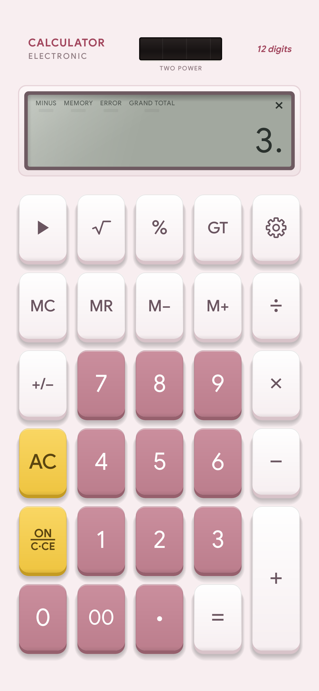
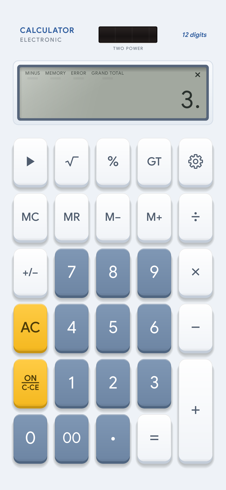

# AcctCalc

**English (GB)** · [正體中文](#正體中文)

| Classic Cream | Obsidian | Mint | Sakura Pink | Sky Blue |
|---|---|---|---|---|
|  |  |  |  |  |

---

## English (GB)

An Android app modelled on the 12-digit business calculator on my desk. Its keys, colours and calculation rules follow the real device and the function card printed on the back of its packaging, and the face is redrawn natively with Android Canvas, down to the depth of the keys, their soft shadows and the way they spring back when pressed. On the home screen it is called **Accounting Calculator** (**會計計算機** on a phone set to Chinese), so it is not mistaken for the built-in calculator.

> The layout and keys are based on the LIBERTY LB-5003CA desk calculator. This is a personal project, not an official product, and it is not affiliated with LIBERTY (利百代).

### Installing

Download [`dist/Calculator-v3.0.1.apk`](dist/Calculator-v3.0.1.apk), open it on your Android phone and allow *Install unknown apps* when asked. Android 6.0 or later is required. What changed in each version is in [`CHANGELOG.md`](CHANGELOG.md).

### Keys

| Key | What it does |
|---|---|
| `+ − × ÷` | Chain calculations. While you enter the second number, the pending operator is shown in the top-right corner of the display. |
| `=` | Finishes the calculation. Afterwards, enter a new number and press `=` to repeat the same operation with it, or press `=` again to repeat it on the result (see *Constant calculation*). |
| `%` | `3000 × 20 %` → 600; `3000 + 20 %` → 3'600 (mark-up); `3000 − 20 %` → 2'400 (discount); `20 ÷ 500 %` → 4 |
| `√` | Square root of the number on the display. It works mid-calculation too: `9 √ × 6 =` → 18. |
| `M+` `M−` `MR` `MC` | Memory. If a calculation is still pending, it is worked out first and the result is stored. |
| `GT` | Grand total: every result of `=` or `%` is added to it, even when `=` follows a single number (`5 =` adds 5); results finished with `M+` or `M−` are not. Press `GT` once to recall it; press it again to clear it, leaving the display as it is. |
| `ON/C·CE` | Press once to clear the number you have just entered (CE), twice to clear the whole calculation (C). Memory and GT are kept. |
| `AC` | Clears everything, memory and GT included. |
| `▶` | Deletes the last digit. |
| `⚙` | Opens the settings (where the OFF key is on the real calculator). |

### Constant calculation

After a calculation, the calculator remembers one of its numbers as a constant. Enter a new number and press `=`, and the same operation is applied to it. With × it keeps the **first** number; with +, − and ÷ it keeps the **second**.

| Operation | Number kept | Example | Works out |
|---|---|---|---|
| × | first | `54 × 5 =` → 270, then `2 =` → 108, `3 =` → 162 | 54 × 2, 54 × 3 |
| ÷ | second (the divisor) | `240 ÷ =` → 0.00416666667, then `2 =` → 0.00833333333, `5 =` → 0.02083333333 | 1 ÷ 240, 2 ÷ 240, 5 ÷ 240 |
| + | second | `5 + 5 =` → 10, then `6 =` → 11, `7 =` → 12, `10 =` → 15 | 6 + 5, 7 + 5, 10 + 5 |
| − | second | `5 − 1 =` → 4, then `3 =` → 2 | 3 − 1 |

- Pressing `=` straight after an operator uses the number on the display as the second number: `20.5 × =` → 420.25 (its square). With ÷ you get the reciprocal: `240 ÷ =` → 1 ÷ 240, and 240 is kept as the divisor.
- Pressing `=` repeatedly keeps applying the operation to the result: `345 + 67 = =` → 479; `678 − 12 = = =` → 642; `5 ÷ = = = =` → 0.0016 (5⁻⁴).
- Splitting $10 in proportion to $60, $30 and $10 (total $100): `10 ÷ 100 =` gives the ratio 0.1, then `× 60 =` gives 6. Because 0.1 is now the constant, `30 =` gives 3 and `10 =` gives 1.

### Display

- Whole numbers always end with a decimal point (`0.`, `190.`), and thousands are separated by `'` (`3'600.`).
- MINUS, MEMORY, ERROR and GRAND TOTAL are printed along the top of the display, and a bar lights up under whichever is active.
- When a negative number fills all 12 digits there is no room for the minus sign, so the MINUS indicator shows it instead.
- Results longer than 12 digits show ERROR with the first 12 significant digits (`123456789 × 8888 =` → `E 1.09728394063`). Press CE to clear the error and carry on with that number.

### Settings

Tap ⚙ to open the settings page.

| Setting | Options |
|---|---|
| Language | System default, 正體中文 or English (UK). On Android 13 and later this is the app's own language setting, so you can also change it under *Settings › Apps › Accounting Calculator › Language*. |
| Position | Top, Centre or Bottom (Bottom by default) |
| Key height | 60% to 100% |
| Display digits | Google Sans, or Seven-segment: AcctCalc Seven, an upright seven-segment font made for this app, whose segments join without gaps |
| Colour theme | Classic Cream, Obsidian, Mint, Sakura Pink or Sky Blue |
| Switch to Obsidian in dark mode | On by default. While the phone is in dark mode the calculator uses Obsidian, and it returns to your chosen theme in light mode; the theme setting is then labelled *Colour theme in light mode*. |
| Replay the tour | A short guided tour runs the first time you open the app; you can watch it again from here. |
| About | Version, what the design is based on, credits, font licences and a link to the web version |


### Building and testing

You don't need Android Studio or Gradle, just JDK 17 or later and two parts of the Android SDK, **build-tools 35** and **platform 34**, unzipped from Google's SDK repository. `build.sh` looks for them in `/opt/asdk/bt35/*/` and `/opt/asdk/p34/*/` unless you point it elsewhere with `BUILD_TOOLS` and `ANDROID_JAR`:

```bash
BUILD_TOOLS=~/Android/Sdk/build-tools/35.0.1 ANDROID_JAR=~/Android/Sdk/platforms/android-34/android.jar ./build.sh
```

Before it builds anything, `build.sh` runs the 103 test cases in `test/cases.txt` against the calculation engine, including every example from the function card, and then 21,000 random key sequences (`test/EngineFuzz.java`), 1,000 of them 100–500 keys long, that check the display never shows anything other than a number of up to 12 digits. It only compiles and signs `build/Calculator.apk` if all of these pass, and any compile error stops the build.

### Project structure

```
app/src/tw/thomas/calc/
  CalcEngine.java        calculation logic (plain Java, so it can be tested on a computer)
  CalcView.java          the calculator face and key animation, drawn with Canvas
  MainActivity.java      starts the calculator and applies the saved settings
  SettingsActivity.java  the settings page
  TourView.java          the first-run tour
  Lang.java              app language (per-app language on Android 13+)
  Theme.java             the five colour themes
  I18n.java              Chinese and English text
app/assets/fonts/        Google Sans and AcctCalc Seven (SIL Open Font License 1.1)
tools/build_font.py      builds the AcctCalc Seven font
test/                    calculation tests
web-prototype/           the first prototype, a web page (HTML/JS)
docs/                    screenshots and the AI usage evidence card
```

### How it was made

1. A web prototype came first (`web-prototype/`), tuned against photos of the real calculator.
2. Its display and calculation rules were then checked against the function card on the packaging and corrected.
3. It was rewritten as a fully native Android app in Java and Canvas, with no WebView.
4. Settings followed (key height, colour theme, position, language), and the OFF key became the settings key.

See [`docs/AI-使用證據卡.md`](docs/AI-使用證據卡.md) (in Chinese) for how AI was used.

### Licences

Google Sans is licensed under the SIL Open Font License 1.1 (`app/assets/fonts/OFL.txt`). AcctCalc Seven was made for this app with `tools/build_font.py` and is released under the same licence (`app/assets/fonts/OFL-AcctCalcSeven.txt`). The app's About section shows both licences in full.

### Acknowledgements

- **Design reference:** the LIBERTY (利百代) LB-5003CA desk calculator and the function card on its packaging. LIBERTY is not involved with this project.
- **Google Sans:** Copyright 2017 Google, Inc., SIL Open Font License 1.1, packaged by [Fontsource](https://fontsource.org).
- **fontTools** and **skia-pathops:** used by `tools/build_font.py` to build AcctCalc Seven.
- **Claude** (Anthropic): developed with Claude; see the AI usage evidence card for what was accepted, changed and rejected.

---

## 正體中文

[English (GB)](#english-gb) · **正體中文**

我把桌上那台 12 位數商用計算機做成 Android App。按鍵配置、配色和運算規則都照實機與包裝背面的功能說明卡；畫面用 Android 原生 Canvas 重畫，保留按鍵的厚度、柔和陰影和按壓回彈的手感。手機語言是中文時，App 在桌面上的名稱是 **會計計算機**，其他語言是 **Accounting Calculator**，以免跟手機內建的計算機搞混。

> 介面與按鍵配置參考利百代 LB-5003CA 桌上型計算機。本專案為個人作品，非官方產品，與利百代公司無關。

### 安裝

下載 [`dist/Calculator-v3.0.1.apk`](dist/Calculator-v3.0.1.apk)，在 Android 手機上開啟並允許「安裝不明來源的應用程式」。需要 Android 6.0 以上。各版本改了什麼，見 [`CHANGELOG.md`](CHANGELOG.md)。

### 按鍵與運算規則

| 按鍵 | 行為 |
|---|---|
| `+ − × ÷` | 連續計算；輸入第二個數時，螢幕右上會顯示目前的運算符號 |
| `=`（常數計算） | 算完一次後，輸入新數字再按 `=` 會重複同樣的運算；直接再按 `=` 則對結果重複運算，見下方說明 |
| `%` | `3000 × 20 %` → 600；`3000 + 20 %` → 3'600（加成）；`3000 − 20 %` → 2'400（折扣）；`20 ÷ 500 %` → 4 |
| `√` | 對螢幕上的數開根號，可以接在算式中（`9 √ × 6 =` → 18） |
| `M+` `M−` `MR` `MC` | 記憶運算；有算式還沒算完時，會先算出結果再存入 |
| `GT` | 每次按 `=` 或 `%` 的結果都會累加到 GT，只輸入一個數字再按 `=` 也算（`5 =` 會加 5）；用 `M+`／`M−` 算出的結果不會。按一下叫出；連按第二下起清空 GT，螢幕數字不變 |
| `ON/C·CE` | 第一下清除剛輸入的數（CE），第二下清除算式（C）；GT 與 M 保留 |
| `AC` | 全部清除，包含 GT 與 M |
| `▶` | 刪除最後一位 |
| `⚙` | 設定（原本 OFF 鍵的位置） |

#### 常數計算

算完一次之後，計算機會記住其中一個數當「常數」。輸入新數字再按 `=`，就會用同樣的運算套上這個常數。乘法記住的是**第一個數**，加、減、除記住的是**第二個數**。

| 運算 | 記住的常數 | 例子 | 實際算的是 |
|---|---|---|---|
| × | 第一個數 | `54 × 5 =` → 270，接著 `2 =` → 108、`3 =` → 162 | 54 × 2、54 × 3 |
| ÷ | 第二個數（除數） | `240 ÷ =` → 0.00416666667，接著 `2 =` → 0.00833333333、`5 =` → 0.02083333333 | 1 ÷ 240、2 ÷ 240、5 ÷ 240 |
| + | 第二個數 | `5 + 5 =` → 10，接著 `6 =` → 11、`7 =` → 12、`10 =` → 15 | 6 + 5、7 + 5、10 + 5 |
| − | 第二個數 | `5 − 1 =` → 4，接著 `3 =` → 2 | 3 − 1 |

- 運算符號後面直接按 `=`，會把螢幕上的數當成第二個數：`20.5 × =` → 420.25（平方）；`240 ÷ =` → 1 ÷ 240（倒數），同時把 240 記成除數。
- 直接再按 `=`，會對結果重複運算：`345 + 67 = =` → 479；`678 − 12 = = =` → 642；`5 ÷ = = = =` → 0.0016（5⁻⁴）。
- 例子：$10 依 $60、$30、$10（合計 $100）按比例分攤。先 `10 ÷ 100 =` 得到比例 0.1，再 `× 60 =` → 6；此時 0.1 成為常數，接著 `30 =` → 3、`10 =` → 1。

螢幕顯示：

- 整數一律帶小數點（`0.`、`190.`），千分位用 `'` 分隔（`3'600.`）。
- 上方印有 MINUS、MEMORY、ERROR、GRAND TOTAL，作用中的項目下方橫條會亮起。
- 12 位數全滿的負數，負號改由 MINUS 指示表示；其他負數的負號放在數字前面。
- 超過 12 位數時顯示 ERROR 和前 12 位有效數字（`123456789 × 8888 =` → `E 1.09728394063`），按 CE 去掉錯誤後可以繼續計算。

### 設定

按 ⚙ 鍵會開啟設定頁。

| 選項 | 內容 |
|---|---|
| 語言 | 跟隨系統／正體中文／English (UK)。Android 13 以上使用系統的「個別 App 語言」，所以也可以在手機的「設定 › 應用程式 › 會計計算機 › 語言」更改 |
| 機身位置 | 偏上／置中／偏下（預設偏下） |
| 按鍵高度 | 60%–100% |
| 螢幕數字字體 | Google Sans，或七段顯示（AcctCalc Seven：本專案自製的直立七段字型，段與段之間沒有縫） |
| 主題配色 | 經典奶油、曜石黑、薄荷綠、櫻花粉、天空藍 |
| 深色模式時自動切換為曜石黑 | 預設開啟：手機切到深色模式時改用曜石黑，切回淺色模式就回到原本選的主題（此時主題選項會標示為「淺色模式下的主題配色」） |
| 重看導覽 | 第一次開啟 App 會出現簡短的導覽，之後可以從這裡重看 |
| 關於 | 版本、設計依據、開發者、字型授權和網頁版連結 |

### 建置與測試

不需要 Android Studio 或 Gradle，只要 JDK 17 以上，以及 Android SDK 的 **build-tools 35** 和 **platform 34**（從 Google 的 SDK 套件庫下載解壓）。`build.sh` 預設會到 `/opt/asdk/bt35/*/` 和 `/opt/asdk/p34/*/` 找；放在別處的話，用 `BUILD_TOOLS` 和 `ANDROID_JAR` 指定：

```bash
BUILD_TOOLS=~/Android/Sdk/build-tools/35.0.1 ANDROID_JAR=~/Android/Sdk/platforms/android-34/android.jar ./build.sh
```

`build.sh` 會先用 `test/cases.txt` 的 103 組案例測試運算邏輯（包含功能說明卡上的全部範例），再跑 21,000 組隨機按鍵序列（`test/EngineFuzz.java`，其中 1,000 組長達 100–500 個按鍵），確認螢幕永遠只會顯示 12 位數以內的數字。全部通過才會編譯、簽章，輸出 `build/Calculator.apk`；任何編譯錯誤都會讓建置停下。

### 專案結構

```
app/src/tw/thomas/calc/
  CalcEngine.java    運算邏輯（純 Java，可以在電腦上測試）
  CalcView.java      計算機畫面與按鍵動畫（Canvas 繪製）
  MainActivity.java  啟動計算機、套用儲存的設定
  SettingsActivity.java  設定頁
  TourView.java      首次開啟的導覽
  Lang.java          App 語言（Android 13 以上的個別 App 語言）
  Theme.java         五種配色
  I18n.java          中英文字串
app/assets/fonts/    Google Sans 和 AcctCalc Seven（SIL Open Font License 1.1）
tools/build_font.py  產生 AcctCalc Seven 字型
test/                運算測試
web-prototype/       最早的網頁版原型（HTML/JS）
docs/                截圖、AI 使用證據卡
```

### 開發過程

1. 先用 HTML/JS 做出網頁原型（`web-prototype/`），對照實機照片調整外觀。
2. 依包裝背面的功能說明卡修正顯示與運算規則。
3. 改寫成純原生 Android App（Java + Canvas），不再使用 WebView。
4. 加入按鍵高度、主題配色、機身位置、語言等設定，並把 OFF 鍵改成設定鍵。

使用 AI 協作的紀錄見 [`docs/AI-使用證據卡.md`](docs/AI-使用證據卡.md)。

### 授權

字型 Google Sans 依 SIL Open Font License 1.1 授權，見 `app/assets/fonts/OFL.txt`。AcctCalc Seven 是本專案自製的字型（`tools/build_font.py`），同樣採用 SIL Open Font License 1.1，見 `app/assets/fonts/OFL-AcctCalcSeven.txt`。App 的「關於」裡可以看到兩份授權全文。

### 致謝

- **設計參考：** 利百代（LIBERTY）LB-5003CA 桌上型計算機，以及包裝背面的功能說明卡。本專案與利百代公司無關。
- **Google Sans：** Copyright 2017 Google, Inc.，SIL Open Font License 1.1，由 [Fontsource](https://fontsource.org) 打包提供。
- **fontTools** 與 **skia-pathops：** `tools/build_font.py` 用它們產生 AcctCalc Seven 字型。
- **Claude**（Anthropic）：本專案與 Claude 協作開發，哪些建議採用、修改或退回，見 AI 使用證據卡。
